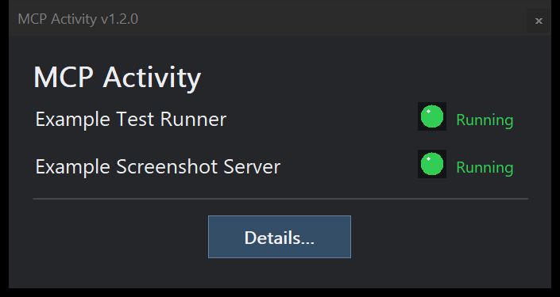
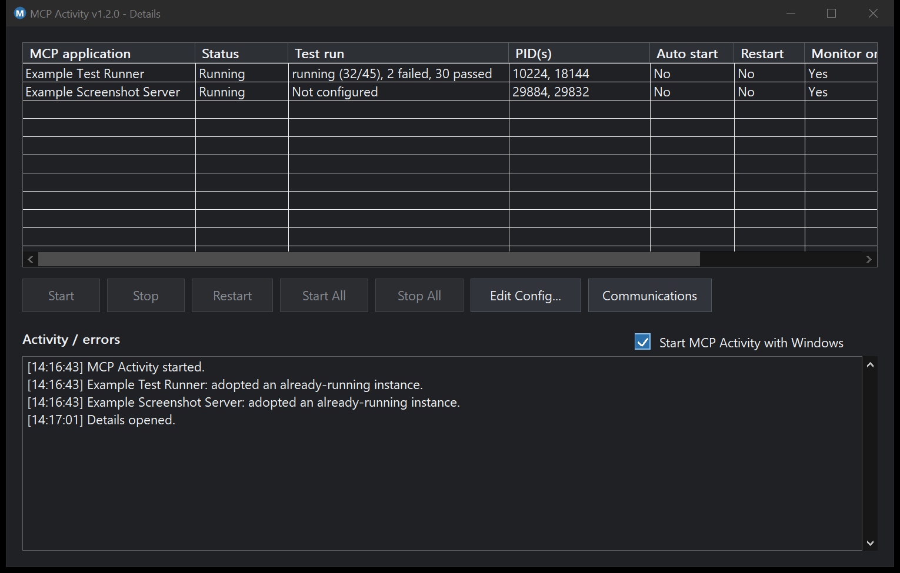

# MCP Activity v1.2.1.1

MCP Activity is a lightweight Windows tray app for **monitoring, managing, and troubleshooting Model Context Protocol (MCP) servers**. It lets you see which helpers are running, restart managed servers when needed, and inspect optional communication diagnostics without navigating several consoles.

## Author and origin

**D. Matthew Pegg — PeggSoft**

Original source:

    https://github.com/LuckyElba/MCPActivity

MCP Activity is released under the **PeggSoft Permissive Attribution License**.
It may be used, modified, distributed, and used commercially for any lawful
purpose, provided attribution to D. Matthew Pegg / PeggSoft and a reference to
the original source repository are retained. See `LICENSE` for the full terms.

## Screenshots

### Compact status window



### Details and test-run monitoring



*Actual MCP Activity window captured with WindowCaptureMCP using an isolated, example-only configuration. The test-run status is supplied by a sample JSON file; two harmless demo processes are genuinely running to demonstrate the green process-status indicators, rather than real MCP servers. This illustrates why test status and server process status must be treated separately.*

## Why use MCP Activity?

- **Visibility:** see running and stopped servers and their process IDs in one place.
- **Recovery:** start, stop, or restart managed servers, with optional automatic recovery.
- **Safety:** observe client-managed servers using Monitor Only without interfering with their lifecycle.
- **Diagnostics:** inspect opt-in metadata about MCP requests, latency, sizes, and errors.
- **Test progress:** independently monitor a test runner's declared run status.

## Quick start

Download the Windows x64 executable from [GitHub Releases](https://github.com/LuckyElba/MCPActivity/releases). Launch it once to generate an example INI alongside the EXE. The generated example profiles enable auto-start and may attempt to launch companion tools; disable or edit unused profiles before regular use. Then configure process identification and optional commands for your MCP servers. Restart MCP Activity to load any edits, and open **Details** to monitor your servers.

## Example: monitoring an MCP test runner

An MCP server can be alive while a test suite is finished, failed, or cancelled. **Server running does not mean tests running.** For a runner that publishes a status file, configure:

```ini
[Example Test Runner]
Command=python.exe C:\MCPServers\TestRunner\server.py
WorkingDirectory=C:\MCPServers\TestRunner
MatchExecutable=python.exe
Match1=TestRunner
Match2=server.py
AutoStart=1
RestartOnFailure=1
TestStatusFile=C:\MCPServers\TestRunner\test-status.json
```

The test runner must write the JSON status file itself, preferably by atomic replacement when a run changes. The following data is illustrative, not a real test result:

```json
{"status":"running","completed":32,"total":45,"passed":30,"failed":2}
```

Accepted `status` values are `pending`, `running`, `completed`, `failed`, and `cancelled`. MCP Activity displays the state and completed/total counts, as well as optional passed/failed counts, in a separate **Test run** column. A missing configured file displays **Unavailable**; profiles without a test status path display **Not configured**. MCP Activity does not infer whether a run has completed from the MCP process being alive. Stale status files retain the last reported state: if a runner crashes without updating its file, the last status may remain visible.

## Features

- Native Win32 C++ application
- Dark UI with per-monitor DPI awareness
- Compact popup showing MCP health
- Notification-area status icon
  - Green: running/healthy
  - Orange: active
  - Red: error
  - Gray: stopped/not loaded
- Start, Stop, Restart, Start All and Stop All controls
- Auto-start and restart-on-failure settings per MCP application
- Activity/error log
- Startup with Windows option
- Config editing through the Windows default `.ini` editor
- `Ctrl+Alt+Shift+M` fallback hotkey to restore the popup
- Automatic tray-icon recovery after Explorer/taskbar restarts
- Hidden child-process launching with no console window
- WMI-based process discovery and adoption of already-running instances

The generated sample configuration includes profiles for Desktop Commander Remote and WindowCaptureMCP. Both tools must be installed separately; disable unused profiles.

## Companion applications

### WindowCaptureMCP

[WindowCaptureMCP](https://github.com/LuckyElba/WindowCaptureMCP) is a read-only
Windows MCP screenshot service by D. Matthew Pegg / PeggSoft. It lets an MCP
client enumerate Windows application windows and capture PNG screenshots.

It is a natural companion to MCP Activity: MCP Activity can start it automatically,
monitor whether it is still running, restart it after a failure, and keep its
console window hidden.

Repository:

    https://github.com/LuckyElba/WindowCaptureMCP

### Desktop Commander Remote

Desktop Commander Remote provides a remote MCP connection between AI clients such
as ChatGPT and the Windows PC. MCP Activity can keep its local Remote Device
process running alongside WindowCaptureMCP.

Desktop Commander can be found at:

- Website: https://desktopcommander.app/
- Remote Desktop Commander GitHub:
  https://github.com/desktop-commander/remote-desktop-commander

The Remote Device can be launched with:

    npx @wonderwhy-er/desktop-commander@latest remote

Before relying on MCP Activity to auto-start Desktop Commander, run Desktop
Commander Remote manually at least once and complete its account/device pairing
if required.

Together, a useful setup is:

    ChatGPT / other AI
           |
           v
    Desktop Commander Remote
           |
           v
    Windows PC
       |        |
       |        +--> WindowCaptureMCP
       |
       +--> other local tools

    MCP Activity monitors and controls both local processes.

## Build

Requirements:

- Windows 10 or later
- Visual Studio with Desktop development with C++
- x64 MSVC toolchain

From a Developer Command Prompt, open `MCPActivity.sln` and build `Release|x64`.

The included `build.bat` currently assumes a specific Visual Studio 18 Insiders path. You may need to edit that path for your installation; building the solution directly in Visual Studio is also supported.

## Configuration

MCP Activity reads `mcp-activity.ini` from the same directory as
`MCPActivity.exe`.

The runtime INI is intentionally not committed because commands and working
directories are machine-specific. If the file does not exist, MCP Activity creates
a default configuration for Desktop Commander Remote and WindowCaptureMCP.

Configuration loads every application section except `[General]`. Existing section names remain compatible:

    [Desktop Commander]
    [ScreenShot]

Additional sections may use descriptive names. Set MonitorOnly=1 for stdio servers owned by an MCP client; this disables launch, stop, restart and automatic recovery for that profile. MatchExecutable optionally requires an exact process executable name.

### Desktop Commander configuration

A working Desktop Commander Remote configuration is:

    [Desktop Commander]
    Command=cmd.exe /d /s /c "npx @wonderwhy-er/desktop-commander@latest remote"
    WorkingDirectory=C:\Users\YourWindowsName
    Match1=desktop-commander
    Match2= remote
    AutoStart=1
    RestartOnFailure=1

Set `WorkingDirectory` to a valid directory for the Windows account running MCP
Activity. When MCP Activity creates a new default INI itself, it uses that user's
Windows profile directory automatically.

The important fields are:

- `Command` starts the Desktop Commander Remote Device without requiring a
  permanently visible command window.
- `Match1` and `Match2` are case-insensitive pieces of process command-line
  text used by MCP Activity to find and adopt an already-running instance.
- `AutoStart=1` starts Desktop Commander when MCP Activity starts if it is not
  already running.
- `RestartOnFailure=1` asks MCP Activity to start it again if the wanted process
  disappears unexpectedly.

Desktop Commander Remote should be paired/authenticated normally before using
MCP Activity as its supervisor.

### WindowCaptureMCP configuration

First install WindowCaptureMCP. The example below assumes it is installed in:

    C:\WindowCaptureMCP

and that its Python virtual environment has been created by its `install.bat`.

Use:

    [ScreenShot]
    Command=cmd.exe /d /s /c ""C:\WindowCaptureMCP\.venv\Scripts\python.exe" "C:\WindowCaptureMCP\server.py""
    WorkingDirectory=C:\WindowCaptureMCP
    Match1=windowcapturemcp
    Match2=server.py
    AutoStart=1
    RestartOnFailure=1

If WindowCaptureMCP is installed somewhere else, change both paths in `Command`
and change `WorkingDirectory` to match.

`Match1=windowcapturemcp` and `Match2=server.py` allow MCP Activity to identify
the WindowCaptureMCP server process from its command line. The `[ScreenShot]` section name is only an example. Any application section name except `[General]` is supported.

WindowCaptureMCP repository:

    https://github.com/LuckyElba/WindowCaptureMCP

### Complete example

A complete configuration for both applications looks like this:

    [General]
    RefreshMilliseconds=1200

    [Desktop Commander]
    Command=cmd.exe /d /s /c "npx @wonderwhy-er/desktop-commander@latest remote"
    WorkingDirectory=C:\Users\YourWindowsName
    Match1=desktop-commander
    Match2= remote
    AutoStart=1
    RestartOnFailure=1

    [ScreenShot]
    Command=cmd.exe /d /s /c ""C:\WindowCaptureMCP\.venv\Scripts\python.exe" "C:\WindowCaptureMCP\server.py""
    WorkingDirectory=C:\WindowCaptureMCP
    Match1=windowcapturemcp
    Match2=server.py
    AutoStart=1
    RestartOnFailure=1

After editing `mcp-activity.ini`, restart MCP Activity so it reloads the
configuration. You can also use the Config control in the Details window to open
the INI in the Windows default editor.

## Source formatting

The project includes `.clang-format` rules for C++ source formatting.

### Monitoring client-managed processes

MCP Activity can observe processes launched and controlled by another application, including MCP servers that communicate over standard input/output (stdio). Define a profile with `MonitorOnly=1`, `AutoStart=0` and `RestartOnFailure=0` to discover matching processes and show their status without taking ownership. Start, Stop, Restart, Start All and Stop All do not control monitor-only profiles. When a client shuts down its process, its status returns to stopped; MCP Activity does not launch a replacement.

For example, add a section to your local `mcp-activity.ini`:

```ini
[Client-managed service]
MatchExecutable=python.exe
Match1=example_server.py
MonitorOnly=1
AutoStart=0
RestartOnFailure=0
```

Use process-matching criteria appropriate to your environment. The compact popup sizes itself for the configured profiles, and the details table labels these entries `Client-managed (monitor only)`.

### Verification and tray startup

Run `MCPActivity.exe --verify-monitoring <absolute-result.ini>` to load the local configuration, discover matching processes and check monitor-only control guards using the verifier's own process ID. The result INI contains `Verification/Passed=1` only when all guard checks pass. The verifier does not use monitored client process IDs for its control-guard exercises.

Launch with `MCPActivity.exe --tray` to start with only the notification-area icon, without showing the popup or taking focus from other applications.

### Experimental MCP communication diagnostics

`mcp_stdio_proxy.py` is an optional, project-independent diagnostic proxy for **stdio** MCP servers. It is not automatically enabled by MCP Activity; the MCP client must be configured to launch the proxy instead of launching its server directly. The proxy then launches the supplied server and forwards standard input and output in both directions. Example:

```powershell
python mcp_stdio_proxy.py --log C:\path\to\private\activity.jsonl -- python C:\path\to\server.py
```

The log contains timestamped JSONL records of direction, message type, JSON-RPC method, a short hash of the request ID, byte counts, response latency (when paired) and whether a response has an error. **Message parameters, results and full payloads are never logged**; there is no payload-capture switch. Treat the metadata log as potentially sensitive, keep it in a private directory and delete it when no longer needed. No application traffic is intercepted merely by process discovery or by enabling `MonitorOnly`.

The Details window now has a **Communications** button. To inspect an existing JSONL metadata log for a profile, add `CommunicationLog=C:\path\to\private\activity.jsonl` to its local INI section, restart MCP Activity, select that profile and press **Communications**. It displays the last approximately 32 KiB as a dedicated communications grid with local-time `DD/MM/YYYY HH:mm` timestamps, direction, method, request ID hash, latency, bytes and errors. The configured log-file path appears in the grid's `Log file` column; double-click a communication row to open that file in Notepad. Click a column heading to change sorting. The selected profile refreshes approximately every 1.2 seconds while Details is open. Once Communications is activated, selecting another MCP application in the upper grid switches the communications display to that application's log automatically. This is passive file inspection: MCP Activity does not intercept an unproxied process, and does not require ownership of the process. Configure this only for trusted local logs; the log remains private and is not uploaded.

An additional **experimental** localhost HTTP proxy is available for Streamable HTTP transports. Run `python mcp_http_proxy.py --listen-port 8766 --upstream http://127.0.0.1:8765/mcp --log C:\path\to\private\http-activity.jsonl`, then configure the client to use `http://127.0.0.1:8766/mcp`. It forwards HTTP GET, POST and DELETE requests, including authentication headers, while logging only metadata. The server binds to `127.0.0.1`, never writes request or response bodies to the log, and does not modify existing MCP configurations. Verify with `python test_http_proxy.py`. This experimental forwarding path has **not** been validated for all Streamable HTTP requirements, including long-lived SSE streams, session termination or reconnection, or arbitrary upstream authentication mechanisms. Use it only with trusted endpoints. The stdio proxy likewise has not been verified with every MCP client or transport. Run `python test_stdio_proxy.py` to smoke-test it.
